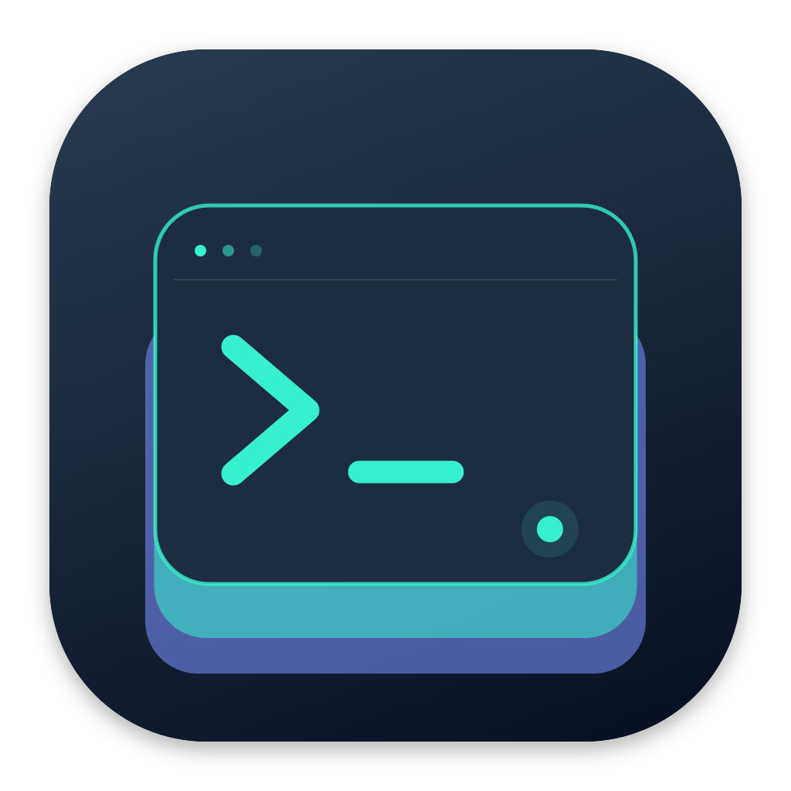

# LocalDeck for macOS & Windows



本机 API、前端服务与终端任务的桌面管理软件。Mac 版使用 SwiftUI，Windows 版使用 Tk；共用带鉴权的本机 API。

## 下载

安装包见 [GitHub Releases](https://github.com/RainFoam0693/LocalDeck/releases)。当前仓库为私有，仅有权限的账号可以访问。

## 打开

双击 `dist/LocalDeck.app`，可拖到「应用程序」。需要 macOS 13+ 和 Python 3（当前开发机已具备）。本地临时签名，尚未做 Apple 公证；其他机器需自行构建或处理系统信任提示。

- **运行中的服务**：扫描当前用户可访问的 TCP 监听进程，显示 PID、端口、命令和目录；点击端口用 HTTP 打开，点击目录在 Finder 打开。
- **停止**：确认后向现有进程发送 SIGTERM，不提权，不批量停止。
- **我的启动项**：名称、目录、zsh 命令；支持启动、停止、重启、最近 100 KB 日志。
- **终端任务**：可托管脚本和非交互命令，启动项继续保存日志；交互式命令可在「应用内终端」中运行，不读取其他终端软件的历史输出。
- 每 4 秒刷新。已有外部服务只能发现、打开或停止；要重启和收集日志，需要添加启动项。
- 退出应用会停止由它启动的任务；已有外部服务不受影响。配置和日志保存在 `~/Library/Application Support/LocalDeck`。日志当前不自动轮转。

## 构建与验证

```sh
./scripts/build.sh
python3 scripts/test_backend.py
./scripts/package.sh --skip-build
```

构建要求 Xcode Command Line Tools，首次构建会通过 SwiftPM 下载固定版本的 SwiftTerm。编译产物为 `dist/LocalDeck.app`。打包脚本另外生成 DMG（含 Applications 快捷方式）、ZIP 和 SHA-256 校验文件。图标由 `scripts/make-icon.swift` 绘制并生成完整尺寸的 ICNS。

## 应用内终端（0.3.0）

Mac 和 Windows 都提供独立的终端工作区，可同时打开多个终端标签。切换终端标签或切到服务列表、启动项页面，只改变可见界面；会话、当前目录、环境变量、运行中的命令和输出都保留。终端会话仅在当前应用运行期间存在，不会在退出后恢复。

- Mac：原生 SwiftTerm + zsh 伪终端，支持 ANSI/VT 输出、方向键、Tab、Ctrl+C、⌘C/⌘V 和滚动历史。
- Windows：pywinpty 伪终端 + pyte VT 屏幕，支持 CMD、PowerShell、方向键、Tab、Ctrl+C、Ctrl+Shift+C/V、颜色和窗口尺寸变化。
- 可在指定目录新建终端；关闭标签会确认并停止该会话，其他终端继续运行。退出应用会清理全部终端。
- 内置终端不提供 SSH 自动重连、分屏或跨应用退出恢复。Windows 的 VT 实现与 Mac 的完整 xterm 仿真存在差异，复杂全屏程序的兼容性可能不同。

Mac 终端烟雾测试：`dist/LocalDeck.app/Contents/MacOS/LocalDeck --terminal-smoke-test`，结果写入 `/tmp/localdeck-mac-terminal-smoke.json`。Windows 的 `--terminal-smoke-test` 会检查双标签隔离、切换页面继续输出、缩放、Ctrl+C、单标签关闭和退出清理；源码和打包 EXE 都会在 CI 中执行。

## Windows 版

适用于 Windows 10/11 x64。下载 [Windows Release](https://github.com/RainFoam0693/LocalDeck/releases/tag/windows-v0.3.1) 中的 EXE 或 ZIP，双击运行；可以放在桌面，内置 Python 与 Tcl/Tk，无需另外安装运行时。当前 Windows 包未做 Authenticode 签名。

功能包括 TCP 监听进程扫描、搜索、打开浏览器和目录、确认后停止进程、命令启动项、启停/重启和最近 100 KB 日志。Windows 命令通过 `cmd.exe /d /s /c` 执行；配置与日志在 `%LOCALAPPDATA%\LocalDeck`。受保护进程可能无法读取信息或停止，程序不会请求提权。Windows 停止操作会终止目标进程；托管任务会同时停止其子进程。使用 `start` 等脱离管理 shell 的任务可能继续运行。「应用内终端」支持独立的 CMD / PowerShell 会话。

开发和打包（在 Windows PowerShell 中）：

```powershell
python -m pip install -r windows/requirements.txt
python windows/app.py
python scripts/test_backend.py
./windows/build.ps1
```

GitHub Actions 会在 Windows runner 上执行真实 TCP 服务测试、桌面 UI 冒烟测试、PyInstaller 打包以及打包后的 EXE 冒烟测试。推送 `windows-v*` 标签会自动发布 Windows 版本。输出为 `dist/LocalDeck-0.3.1-Windows-x64.exe`、ZIP 和 SHA-256 校验文件。

## 后端 API

应用自动启动后端，绑定 `127.0.0.1` 随机端口，使用每次启动生成的 Bearer Token，不向局域网暴露。可以独立启动：

```sh
python3 backend/server.py --port 8765
```

第一行 JSON 返回端口和 token，请求须带 `Authorization: Bearer <token>`。

| 方法 | 路径 | 用途 |
|---|---|---|
| GET | `/state` | 服务配置、运行状态、监听进程 |
| POST | `/services` | 创建；JSON: name, command, directory |
| POST | `/services/{id}/start` | 启动 |
| POST | `/services/{id}/stop` | 停止任务进程组 |
| POST | `/services/{id}/restart` | 重启 |
| POST | `/services/{id}/delete` | 停止并删除 |
| GET | `/logs/{id}` | 最近 100 KB 日志 |
| POST | `/processes/stop` | 停止外部监听进程；JSON: pid, command，校验进程命令仍匹配 |

配置支持 `LOCALDECK_DATA_DIR` 环境变量覆盖，便于隔离测试。Mac 启动项通过当前用户的 `/bin/zsh -lc` 执行，Windows 使用 `cmd.exe`，适用于自己信任的本机命令。守护进程化或主动脱离进程组的命令不保证退出时被回收。
